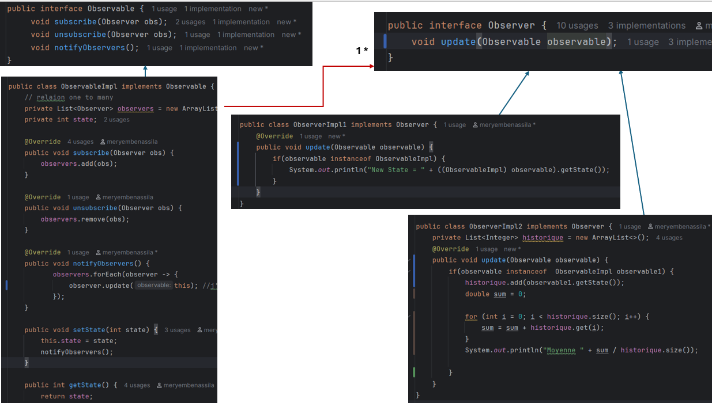
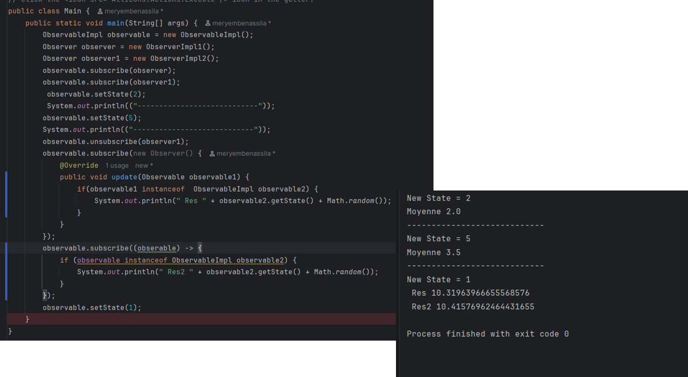

# Design Pattern Observer

Ce projet met en pratique le **Design Pattern Observer**, qui permet à un objet (*Subject*) de notifier automatiquement ses observateurs (*Observers*) lorsqu'un changement d'état se produit.

## 1. Technique Push

Dans l'approche **Push**, le `Subject` transmet directement aux observateurs les données nécessaires lors de la notification.

### Diagramme de séquence

### Implémentation

### Test

## 2. Technique Pull

Dans l'approche **Pull**, le `Subject` notifie les observateurs qu'un changement a eu lieu, puis ceux-ci récupèrent eux-mêmes les données nécessaires auprès du `Subject`.

### Diagramme de séquence

### Implémentation

### Test

## Conclusion

Les deux techniques permettent de notifier automatiquement les observateurs. La différence réside dans la transmission des données : **Push** transmet les données lors de la notification, tandis que **Pull** laisse les observateurs les récupérer auprès du `Subject`.